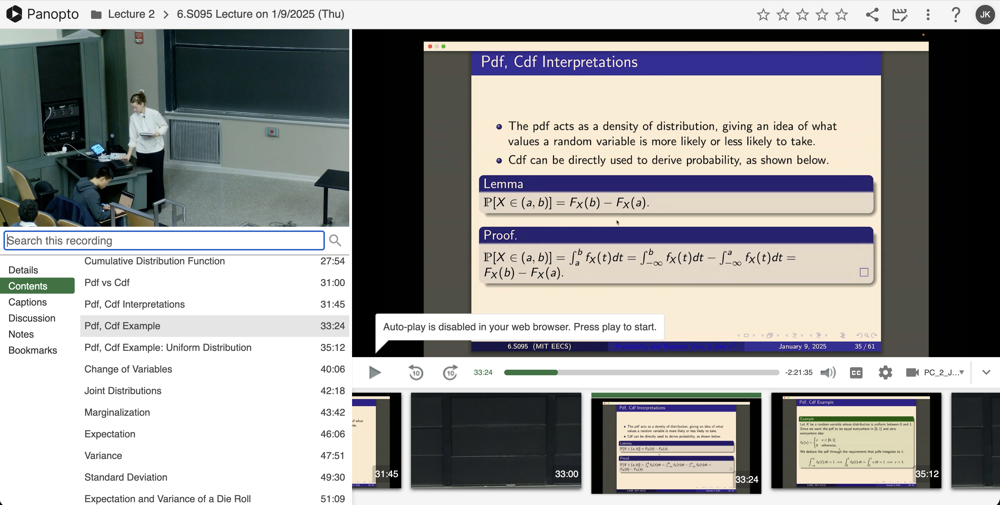

# Final Project 2: Problem Framing

## Domain

At MIT, recorded lectures are a resource that students use to review material before exams, review missed lectures, and revisit concepts that they did not understand the first time. MIT courses are frequently hosted on general-purpose platforms like YouTube -- such as MIT's [6.5940](https://www.youtube.com/@MITHANLab/live) -- and educational platforms like Panopto video. Reviewing a recording offers students the option to pause and rewind, allowing them to work through content at their own pace.

  
   
  <em>MIT's Panopto view. (source: MIT 6.S095 2025)</em>

Though recorded lectures offer the benefit of replay, watching alone gives students fewer opportunities to ask questions as they arise. Recitations often fill that gap: if an instructor's explanation is unclear, a student may ask follow-up questions and obtain clarification. Classmates can also offer their own explanations while the material is still in front of them. In contrast, a student watching the recording alone may have to work out connections on their own.

For this reason, some students prefer reviewing past material in groups, where they can stop at points of confusion and discuss. Group review can take place in person or remotely. In person, students can share notes and stream lecture videos, talking out loud and using a chalkboard to work through steps. Virtually, students can share notes or stream a lecture recording over a call, but the virtual environment can demand more coordination to work together than what is required in person.

## Bad Situations

When students review a recorded lecture remotely, they may use a call to discuss the material while one student shares the video. This lets the group watch the same recording, but it can make it harder for individuals to move at their own pace or revisit the discussion afterward. This creates several bad situations:

1. **Centralized playback controls.** Three classmates are reviewing a recorded lecture before an exam. When the lecturer moves to the next slide, one student is still trying to follow the previous equation. They ask the person sharing to rewind, but the video jumps back too far. The student has trouble explaining at what moment they want to pause, and the person sharing faces the added challenge of managing everyone's requests.
2. **Reduced video quality.** Two students are reviewing a recorded lecture in which the instructor walks through an implementation. The text in the code editor appears blurry in the screen share, making it difficult for one student to read the code as the instructor explains it. The student misses out on a key portion of the lecture, or they must open the recording themselves and review the content separately or asynchronously.
3. **Lost discussion context.** During a study group review, a student asks about a concept that was explained vaguely in lecture, and a classmate explains it. The next day, the student encounters the same concept on a practice exam, but can't recall their classmate's reasoning. The student can return to the lecture recording to rewatch the instructor's explanation, but they would need to work it out again or ask their classmate to repeat their explanation.

## Evidence and Corroboration

TODO

https://eric.ed.gov/?id=EJ1032559
https://www.reddit.com/r/UPSC/comments/1ijygjl/in_case_you_find_difficulty_in_maintaining/
https://community.w2g.tv/t/is-it-possible-to-have-access-to-my-chat-history/196933
https://www.reddit.com/r/UIUC/comments/imuaxt/zoom_lecturesdiscussions_suck/
https://www.reddit.com/r/McMaster/comments/iq1lre/online_uni_is_v_hard_says_mac_student/

## Workarounds and comparables

TODO

## Solution sketch

TODO

## Ethical analysis

TODO
