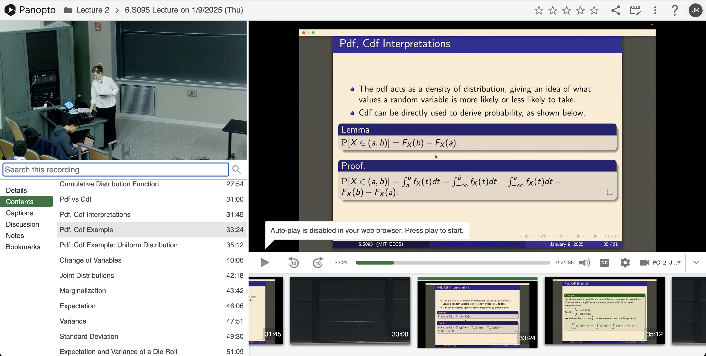
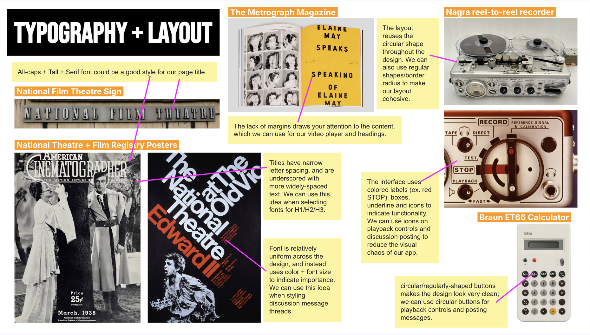
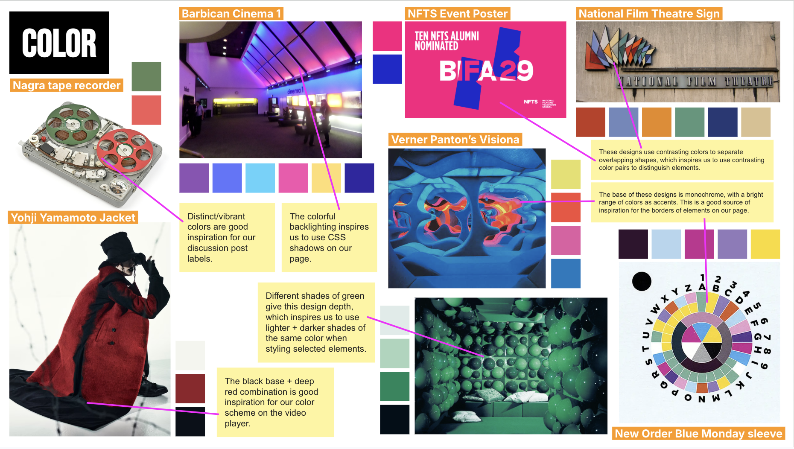
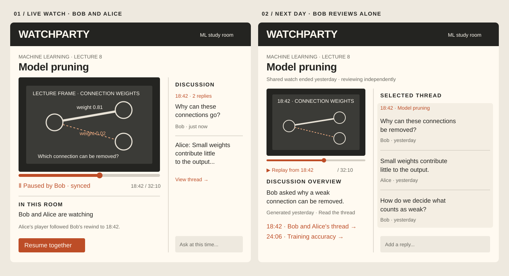

# Final Project 3: Concept Design

[Problem framing](#revised-problem-framing) · [Concept design](#concept-design) · [User journey](#user-journey) · [Visual design study](#visual-design-study) · [Design summary](#design-summary) · [Development plan](#development-plan)

## Revised Problem Framing

### Domain

At MIT, recorded lectures are a resource that students use to review material before exams, review missed lectures, and revisit concepts that they did not understand the first time. MIT courses are frequently hosted on general-purpose platforms like YouTube -- such as MIT's [6.5940](https://www.youtube.com/@MITHANLab/live) -- and educational platforms like Panopto video. Reviewing a recording offers students the option to pause and rewind, allowing them to work through content at their own pace.

<p align="center">
  
  <br>
  <em>MIT's Panopto view. (source: MIT 6.S095 2025)</em>
</p>

Though recorded lectures offer the benefit of replay, watching alone gives students fewer opportunities to ask questions as they arise. Recitations often fill that gap: if an instructor's explanation is unclear, a student may ask follow-up questions and obtain clarification. Classmates can also offer their own explanations while the material is still in front of them. In contrast, a student watching the recording alone may have to work out connections on their own.

For this reason, some students prefer reviewing past material in groups, where they can stop at points of confusion and discuss. Group review can take place in person or remotely. In person, students can share notes and stream lecture videos, talking out loud and using a chalkboard to work through steps. Virtually, students can share notes or stream a lecture recording over a call, but the virtual environment can demand more coordination to work together than what is required in person.


### Bad Situations

When students review a recorded lecture remotely, they may use a call to discuss the material while one student shares the video. This lets the group watch the same recording, but it can make it harder for individuals to move at their own pace or revisit the discussion afterward. This creates several bad situations:

1. **Centralized playback controls.** Three classmates are reviewing a recorded lecture before an exam. When the lecturer moves to the next slide, one student is still trying to follow the previous equation. They ask the person sharing to rewind, but the video jumps back too far. The student has trouble explaining at what moment they want to pause, and the person sharing faces the added challenge of managing everyone's requests.
2. **Reduced video quality.** Two students are reviewing a recorded lecture in which the instructor walks through an implementation. The text in the code editor appears blurry in the screen share, making it difficult for one student to read the code as the instructor explains it. The student misses out on a key portion of the lecture, or they must open the recording themselves and review the content separately or asynchronously.
3. **Lost discussion context.** During a study group review, a student asks why the lecturer can remove certain connections from a model. A classmate explains it while they look at the diagram together. The next day, the student encounters model pruning on a practice exam but can't recall the reasoning. They can find the diagram in the recording, yet the explanation that made it click was in yesterday's conversation. They spend time reconstructing it or ask their classmate to repeat it.

### Evidence and Corroboration

A study of groups watching course videos together found that students wanted to stay in sync, while giving each student control of the video led to more pauses and interaction.[^1] This speaks to the first bad situation: a student should be able to stop at the equation they missed without asking someone else to operate the video. A student describing a recorded-lecture study group on r/UPSC[^3] liked their "watch party method" over Zoom or Google Meet, but also valued having one person keep the group on track. Shared controls therefore need to be visible to everyone, so a pause or rewind does not leave the rest of the group wondering what happened.

In a study of groups watching instructional videos from different locations, the researchers compared ways to discuss the video while sharing playback controls.[^5] Groups using only text chat kept watching rather than pausing to talk, and participants had trouble attending to the chat and video at once. This is a reason to let a group pause together and to keep the written discussion available after the watch, instead of expecting students to read every message while the lecture plays. A student on r/McMaster[^2] put a related loss plainly: in asynchronous lectures, "we do not get to learn from other students' questions".

The screen share can also get in the way of the material itself. Zoom's screen-sharing guidance warns that optimizing a share for video can make other content blurry.[^7] That tradeoff matters when a lecture switches between a moving demonstration and small code or labels. Giving each student the original recording lets them use their own player to read the detail while staying at the group's current point.

Returning to the right moment matters too. In the Collaborative Lecture Annotation System, students could mark points in a lecture and use those annotations to navigate back to the video during review.[^6] A Watch2Gether user asked how to recover messages from a previous watch, and the service replied that it did not store room chat history.[^4] Taken together, these show the value of keeping a classmate's question or explanation attached to the part of the recording it addresses, so it is there when a student returns to study.

### Workarounds and comparables

Students can currently use screen-sharing platforms or alternative synced-playback applications when they want to watch a lecture together. These approaches make some form of collaboration possible, but each introduces friction or leaves one of the bad situations unresolved.

#### Workarounds

**Screen sharing.** Students can join a video call, and rely on one person's screenshare to watch the lecture synchronously. Everyone sees the same recording, but the person sharing handles playback requests, small text can be hard to read, and out-loud discussion goes undocumented.

**Separate playback.** While in a call together, students can independently open the original video and control their own player. But, when someone wants to discuss a specific moment, they have to tell everyone else which timestamp to jump to. To revisit the discussion context later, someone has to write down both the explanation and its timestamp.

Several existing applications also provide the capacity for shared video discussion, but each has drawbacks in their support for collaboration.

#### Comparables

**FaceTime SharePlay.** [SharePlay](https://support.apple.com/guide/iphone/shareplay-watch-listen-play-iphb657eb791/ios) lets students watch a video in sync during a FaceTime call, with each participant able to pause or rewind for the group. However, the feature is only supported within FaceTime on iOS and MacOS devices, presenting barriers to groups of students with Android users. Students also have the option of returning to a recording later, but the lack of timestamped history makes it challenging to identify key moments.

**Watch2Gether.** 
With [Watch2Gether](https://w2g.tv/en/), one student can create a private room and send classmates a link to join. Students can watch a video in sync and discuss it in the room's live chat, allowing the group to pause or rewind together. However, Watch2Gether does not retain room chat history[^4], so students who refresh the page can lose explanations shared during the session.

**Annoto.** [Annoto](https://www.annoto.net/) adds timestamped comments to an existing video player, allowing students to revisit a classmate's explanation alongside the part of the lecture it refers to. 
However, Annoto's platform requires individual course setup, led by a "teacher" role who must enable commenting. This extra configuration makes Annoto challenging to use for informal study groups, and during live review the group still has to coordinate playback separately.

These tools split the task in two: the group can either watch together or keep a discussion tied to the recording, but has trouble doing both in the same place. The lost-discussion situation is the part we find most promising. Bob can recover the lecture's diagram the next day, but not the conversation that helped him understand it. The opportunity is to carry that moment of group understanding into his next study session, with the video and discussion still together.

### Solution sketch

We propose WatchParty, a web-based application for small groups to review recorded lectures. During a live watch, each student plays the original video on their own device, while the group shares playback controls and a timestamped discussion. Students can still talk over a call, using the written threads for questions and explanations they want to return to. Later, a student can return to the same video and discussion at their own pace. A room keeps those video and discussion records even after a shared watch ends.

- **Integrated video player.** Students would watch the lecture in an embedded player, so they could stream in HD directly from the source video. Our application can initially support YouTube, with Panopto as a (verified) possible extension.
- **Shared playback controls.** Students can pause or rewind for the group from their own player, and see others' actions on their view. The entire group can stop to address a question, and understand what moments caused confusion.
- **Private study rooms.** A student could create a room and invite classmates by sharing a link, making it easy for others to join.
- **Timestamped discussion.** Students could attach questions and replies to a specific moment in the recording, allowing students to quickly identify moments of discussion.
- **Discussion history.** Students could return after the session to revisit or add questions and replies. An optional summary could point them to threads worth rereading, while keeping the original replies in view.

### Ethical analysis

In our ethical analysis, we have considered the following potential impacts of the use of WatchParty:

- **Confidence to pause** *(Stakeholders -- Direct Stakeholders)*
  - When students need more time to follow an explanation, it may feel daunting to pause or rewind for the whole group.
  - In response, we could add a feature allowing students to flag a particular timestamp without explicitly pausing the whole group. Other members of the group can choose to address flags as they arise (like a raised hand), or periodically stop to address them (like a lecture pause for questions).
- **Overreliance on summaries** *(Values -- Consider Key Values at Stake)*
  - Students may rely strictly on the discussion or AI overview to quickly review the lecture, undermining the benefit of watching the lecture themselves, spending time on the material, and asking their own questions.
  - In response, we could limit the visibility and generation of AI overviews for each stream. A student would need to explicitly click to request an AI overview, encouraging them to first view the video and lecture content themselves.
- **Use for casual viewing** *(Time -- Reappropriation)*
  - Over time, people may shift to using WatchParty for casual YouTube viewing (much like Watch2Gether). This could make it easier for friends to spend time together online, through live reactions or later replies.
  - We would add a live "reaction" feature (like the heart in YouTube's live chat) while maintaining nested discussion posting, so that users can more clearly express themselves in casual viewing, and repurpose the chat for either use case.
- **Answer credibility** *(Stakeholders -- Indirect Stakeholders)*
  - The platform has the potential to impact course instructors who do not use it, as instead of relying on staff explanations, students may share and propagate incorrect explanations that the instructor cannot correct within the private room.
  - In response, we can have an AI-powered feature that parses discussion to detect potential answers, and labels them as unverified. This can caution students to rely on provided answers, without offering explicit value judgement (correct vs. incorrect).
- **Fragmented review** *(Pervasiveness -- Widespread Use)*
  - If private rooms become the norm for exam review, useful explanations might only circulate among the classmates invited to one room, whereas the rest of the class could benefit from hearing those answers.
  - In response, we could create a "class group" feature, where a stream's link is made automatically accessible to a group of users. Students can add each other to groups, making history accessible to a larger group who may benefit.
- **Deletion of posts** *(Values -- Value Tensions)*
  - A student may want to have control over which discussion posts of theirs are kept up, but deleting a post could delete insightful answer threads and lessen the benefit of review.
  - In response, we could let students edit their own posts. The "edit" option may encourage students to follow-up on their own posts rather than deleting them, supporting the goal to maintain discussion history.

## Concept Design


In addition to generic `Authenticating` and `Sessioning` concepts used to manage user accounts and identity, we have the following four concepts to describe the core functionality of WatchParty: `RoomJoining`, `Streaming`, `Discussing`, and `Summarizing`.

### RoomJoining

```text
concept RoomJoining [Identity]
purpose Allow a group to gather privately for a shared activity.
principle One user creates a room;
  They share the code with a second user, who joins by code;
  The user leaves the room, and later they may rejoin using their saved participant.
state
  a set of Rooms with
    a unique code String
    an owner Identity

  a set of Participants with
    a room Room
    an identity Identity
    a name String
    an active Flag
    unique room and identity

  Rule: Each Participant name must be nonempty and at most 32 characters.
actions
  create (identity: Identity, name: String) : return (room: Room, participant: Participant, code: String)
    where the name is between 1-32 characters
    then generate a random code not shared by any other room;
         create a Room with that code, and identity as owner;
         create a Participant with the created room, given identity, and given name, active = true;
         return the room, participant, and code.

  join (code: String, identity: Identity, name?: String) : return (room: Room, participant: Participant)
    where the code identifies an existing room;
          name is supplied if no Participant exists for that room and identity, and (if supplied) is between 1-32 characters
    then if there already exists a Participant for that room and identity, use it and preserve its name;
         otherwise create a Participant with the room, identity, and provided name;
         set active = true;
         return the room and participant.

  transferOwnership (room: Room, current: Participant, successor: Participant)
    where the current Participant belongs to and owns the given room, and is active;
          successor is an active Participant in it
    then change the given room's owner to the successor's identity.

  leave (participant: Participant)
    where the given participant exists
    then set the participant's active flag to false.
```

**Note.** A Participant remains associated with a room after leaving it. This lets someone rejoin with the same name, and keeps authorship on earlier discussion messages. The active flag distinguishes a current member from someone who has left.

### Streaming

```text
concept Streaming [Scope, Viewer, Media]
types
  Playback is PLAYING or PAUSED
  Control is PLAY or PAUSE or SEEK
purpose Keep a group at the same point in a recording while they watch together.
principle A viewer adds a video to a group's collection and opens a shared watch;
  They start watching that video with the group;
  Another viewer pauses the video, so playback pauses for everyone;
  A viewer rewinds and resumes playback, so the group continues watching from that point;
  Finally, the shared watch ends, but the video remains available for another watch or independent review.
state
  a set of Streams with
    a scope Scope
    a playback Playback
    a position Number
    a positionAt DateTime
    an optional activeEntry VideoEntry
    an optional endedAt DateTime

  a set of VideoEntries with
    a scope Scope
    a source Media
    an order Number
    unique scope and order

  a seq of ControlEvents with
    an operation Control
    a viewer Viewer
    a stream Stream
    an entry VideoEntry
    a position Number
    an offset Number

  Rule: At most one Stream per scope has no endedAt.
  Rule: An ended Stream has an activeEntry and is paused.
  Rule: Each Stream's activeEntry has the same scope as that Stream.
  Rule: A Stream's position is nonnegative.
  Rule: Changes to one Stream take effect in the order they are accepted. Each change uses the state left by the previous accepted change.
actions
  open (scope: Scope) : return (stream: Stream)
    where no Stream for the given scope has no endedAt
    then create a Stream with the given scope, paused at 0, positionAt = current time, and no activeEntry or endedAt;
         return it.

  addVideo (scope: Scope, source: Media) : return (entry: VideoEntry)
    then create a VideoEntry with the given scope and source;
         set order to zero if the scope has no VideoEntries, else 1 + (its highest existing order);
         return that VideoEntry.

  start (stream: Stream, entry: VideoEntry)
    where the Stream exists, has no activeEntry or endedAt, and has the same scope as the given VideoEntry
    then set the stream's activeEntry to the given VideoEntry, playback to PAUSED, position to zero, and positionAt to the current time.

  switchVideo (stream: Stream, entry: VideoEntry)
    where the Stream is live (has an activeEntry and no endedAt), and has the same scope as the given VideoEntry
    then if the VideoEntry is already active, leave playback as it is;
         otherwise set activeEntry to the given VideoEntry, playback to PAUSED, position to zero, and positionAt to the current time.

  control (stream: Stream, viewer: Viewer, entry: VideoEntry, operation: Control, position?: Number, offset?: Number) : return (changed: Flag)
    where the Stream exists, has an activeEntry, and has no endedAt;
          entry equals the Stream's activeEntry;
          if the operation is SEEK, exactly one of position or offset is supplied, and the resulting position is nonnegative;
          if the operation is PLAY or PAUSE, neither position nor offset is supplied.
    then if the operation causes no change (i.e. playback = PLAYING and operation = PLAY, or PAUSED + PAUSE), return false;
         calculate the Stream's current position: (stored position) if PAUSED, and stored position + (current time - positionAt) if PLAYING;
         for SEEK operations: set the Stream's position to the supplied position, or current position plus offset;
         for PLAY or PAUSE operations: set the Stream's position to the current position, and playback to PLAYING or PAUSED respectively;
         set positionAt to the current time;
         add a ControlEvent with the given stream, entry, viewer, operation, the Stream's resulting position, and supplied offset if exists for SEEK (or zero otherwise);
         return true.

  end (stream: Stream)
    where the Stream exists and is live (has an activeEntry, and no endedAt)
    then compute and update the stream's current position as in control;
         set playback to PAUSED;
         set positionAt and endedAt to the current time.
```

**Notes:** 
- If Alice and Bob both seek at almost the same time, the second accepted control uses the position left by the first. If someone switches videos before a control is accepted, the old entry no longer matches the active entry, so that control is rejected. Each viewer then catches up from the accepted Stream state.
- The purpose of storing `positionAt` is to allow a user to catch up with the current stream even if an action has not occurred recently. For instance, if a user joins mid-stream, they will be able to calculate where users are currently at, and sync with their stream.
- We distinguish `offset` from `position` so the viewer can tell a ten-second skip from a jump to a specific time. The player should also keep a seek within the actual video duration; `Streaming` itself does not know the duration of a generic Media source.

Bob's question about model pruning shows why the video belongs to the room rather than to one watch:

| When | Streaming | Discussing | What Bob can do |
| --- | --- | --- | --- |
| Group review | Stream A plays VideoEntry V. | Bob starts Thread T at 18:42 on V; Alice replies. | Pause the group at the diagram and ask why connections can be removed. |
| Exam practice the next day | Stream A has ended; V is still in the room. | T and Alice's reply are still attached to V at 18:42. | Open the recording at 18:42 and reread her explanation on his own. |
| Another group review | Stream B plays the same V. | T remains on V; it is not copied into Stream B. | Return to the same question with the group. |

One VideoEntry gives the live watch and later review a common reference. Streams record each occasion on which the group watches it; threads record what the group learned about the video.

### Discussing

```text
concept Discussing [Topic, Author, Anchor, Context]
purpose Allow users to discuss specific (anchored) parts of a topic, and revisit their discussion.
principle An author starts a thread at an anchor in a topic;
  A second author replies to the opening message;
  Later, a user returns to that anchor, and reads the thread and its replies.
state
  a set of Threads with
    a topic Topic
    an anchor Anchor

  a set of Messages with
    a thread Thread
    an optional parent Message
    an author Author
    a name String
    a text String
    a context Context
    a postedAt DateTime

  Rule: For each Thread, there is exactly one Message associated with it that has no parent (i.e. the opening message).
  Rule: A reply's parent belongs to the same Thread, and was posted before the reply.
actions
  startThread (topic: Topic, author: Author, name: String, anchor: Anchor, text: String, context: Context) : return (thread: Thread, message: Message)
    where the given text is nonempty
    then create a Thread with the given topic and anchor;
         create a Message with the created Thread, no parent, the given author, name, text, context, and postedAt = the current time;
         return the created thread and message.

  reply (parent: Message, author: Author, name: String, text: String, context: Context) : return (message: Message)
    where the parent Message exists and the given text is nonempty
    then create a Message with the parent's Thread, the given parent, author, name, text, context, and postedAt = the current time;
         return the Message.
```

**Note.** The purpose of the `Topic` is to give a scope for the discussion, i.e. the `VideoEntry` in the case of WatchParty. The `Anchor` differs, as it specifies the context within the topic that a thread pertains to (i.e. a timestamp).

### Summarizing

```text
concept Summarizing [Topic, Item]
purpose Help users find earlier material by reading a saved overview with links back to its sources.
principle A user requests a summary of a collection of items about a topic;
  They use a reference in the overview to return to an original item;
  After new material is added, they request a new summary to replace it.
state
  a set of Summaries with
    a unique topic Topic
    a content String
    a referencedItems set of Item
    a generatedAt DateTime
actions
  summarize (topic: Topic, items: seq of (item: Item, text: String)) : return (summary?: Summary, failed: Flag)
    where the given items are nonempty
    then ask a text summarizer for an overview and references to the input items;
         if generation fails, or any returned reference is not among the input items, leave the state unchanged and return no summary and failed = true;
         otherwise use the existing Summary for the given topic, or create one if none exists;
         set its content to the generated overview, referencedItems to the returned items, and generatedAt to the current time;
         return that Summary and failed = false.
```

**Note.** `Summarizing` relies on an available text summarizer, which we will implement by prompting a Gemini agent. `Topic` is a VideoEntry and each `Item` is a discussion Thread. We will pass each thread's messages together with its identifier. The summary is a way into the original discussion, not a replacement for it. If there are no threads, we will show that state instead of requesting a summary. After a failed request, the previous summary remains available, with its generation time shown.

### Essential reactions

Reactions can be roughly categorized by the concept they apply to. We categorize and list the key reactions of WatchParty below.

The following reactions govern room creation, joining by invitation, and ownership transfer:

```text
when Requesting.createRoom(identity, name)
then RoomJoining.create(identity, name)

when RoomJoining.create(identity, name): (room, participant, code)
then Streaming.open(room)

when Requesting.joinRoom(identity, code, name)
then RoomJoining.join(code, identity, name)

when Requesting.leaveRoom(identity, room)
where RoomJoining: participant has the given room and identity, and active = true
then RoomJoining.leave(participant)

when Requesting.transferOwnership(identity, room, successor)
where RoomJoining: current has the given room and identity, and active = true;
      RoomJoining: the room's owner equals identity;
      RoomJoining: successor has the given room and active = true
then RoomJoining.transferOwnership(room, current, successor)
```

**Note.** We assume each request supplies an identity, which is verified through authentication and session management (intentionally omitted from our concept list, as they will be generic).

**Read access.** A request to view a room's videos, current or past Streams, threads, or saved summaries requires an active Participant with the requester's identity in that room. The requested video, Stream, thread topic, or summary topic must belong to the same room. Someone who has left must rejoin before reading the history again. These checks also apply when a student opens a link to a particular thread; knowing its link does not grant access to the room.

The following reactions govern stream management and interaction:

```text
when Requesting.addVideo(identity, room, source)
where RoomJoining: participant has the given room and identity, and active = true;
      RoomJoining: the room's owner equals identity
then Streaming.addVideo(room, source)

when Requesting.openWatch(identity, room)
where RoomJoining: participant has the given room and identity, and active = true;
      RoomJoining: the room's owner equals identity
then Streaming.open(room)

when Requesting.startWatch(identity, room, entry)
where RoomJoining: participant has the given room and identity, and active = true;
      RoomJoining: the room's owner equals identity;
      Streaming: stream has scope = room and no endedAt
then Streaming.start(stream, entry)

when Requesting.switchVideo(identity, room, entry)
where RoomJoining: participant has the given room and identity, and active = true;
      RoomJoining: the room's owner equals identity;
      Streaming: stream has scope = room and no endedAt
then Streaming.switchVideo(stream, entry)

when Requesting.controlPlayback(identity, room, entry, operation, position, offset)
where RoomJoining: participant has the given room and identity, and active = true;
      Streaming: stream has scope = room and no endedAt
then Streaming.control(stream, participant, entry, operation, position, offset)

when Requesting.endWatch(identity, room)
where RoomJoining: participant has the given room and identity, and active = true;
      RoomJoining: the room's owner equals identity;
      Streaming: stream has scope = room and no endedAt
then Streaming.end(stream)
```

**Note.** Streaming's Scope is a Room, and Viewer is a Participant. Room creation opens the first shared watch; `openWatch` creates another after the previous one ends. Shared playback requests use these reactions, while independent playback stays local to the viewer's player. A viewer arriving mid-watch reads the current Stream position and `positionAt` to catch up.

The following reactions govern discussion during a shared watch and afterward:

```text
when Requesting.startThread(identity, room, entry, position, text, context)
where RoomJoining: participant has the given room and identity, active = true, and name;
      Streaming: entry has scope = room;
      context is HISTORICAL, or context is LIVE and stream has scope = room, activeEntry = entry, and no endedAt
then Discussing.startThread(entry, participant, name, position, text, context)

when Requesting.reply(identity, room, parent, text, context)
where RoomJoining: participant has the given room and identity, active = true, and name;
      Discussing: parent belongs to thread, and thread has topic = entry;
      Streaming: entry has scope = room;
      context is HISTORICAL, or context is LIVE and stream has scope = room, activeEntry = entry, and no endedAt
then Discussing.reply(parent, participant, name, text, context)
```

**Note.** Discussing's Topic is a VideoEntry, Author is a Participant, Anchor is a timestamp, and Context is either LIVE or HISTORICAL. Both kinds of message remain in the same thread after a shared watch ends.

Lastly, a member can request an overview of the discussion for one video entry:

```text
when Requesting.summarizeDiscussion(identity, room, entry)
where RoomJoining: participant has the given room and identity, and active = true;
      Streaming: entry has scope = room;
      Discussing: items contain each Thread with topic = entry and the text of its Messages
then Summarizing.summarize(entry, items)
```

**Note.** Summarizing's Topic is a VideoEntry and Item is a Thread. The thread references in the summary let a student jump to the original exchange and its timestamp.

## User Journey

Alice and Bob are students reviewing a recorded machine learning lecture before an exam. They initially watch over a call while Alice shares her screen. During an explanation of model pruning, Bob struggles to read a visual, and falls behind. He asks Alice to rewind, but she jumps past the section he wanted to revisit.

Bob signs into WatchParty, creates a private room, and shares its invitation link with Alice. He adds the lecture's YouTube link and starts the shared watch. Each student watches directly in their own player, while their playback stays synchronized.

When they reach the explanation of model pruning, Bob pauses and rewinds to 18:42, and Alice's player follows his change. Bob starts a thread there asking why those network connections can be removed. Alice explains that connections with small weights contribute little to the model's output. Bob understands why the example connection can go, then asks how to tell which weights are small enough to remove. He resumes playback for both of them.

Once they finish reviewing, Bob ends the shared watch. The next day, he encounters a pruning question on a practice exam but cannot recall Alice's reasoning. Their review produced several threads, so he reopens the room and requests a discussion summary to find the pruning question. A reference takes him to their thread at 18:42. He replays that section independently, referring to Alice's reasoning while working through the practice question. Their room could host another shared watch of this video without losing that thread.

## Visual Design Study

Below are our two visual design slides, also available [here](https://docs.google.com/presentation/d/1vi8HeOgCn2IL2OZpDbWJqKiH4u38_5ZhHh5meYynQP0/edit?usp=sharing).

<p align="center">
  
  
</p>

For the app, we would use the warmer, simpler parts of these references: an off-white page, charcoal text, and orange for the current playback state and primary actions. The other bright colors on the slides are possible references, not colors we plan to use all at once. We would use a condensed sans face for page titles and a plain sans face for lecture notes and discussion messages. The player should take most of the space during a live watch; threads sit beside it, with the timestamp leading each question. In the later review view, the selected thread gets more space and the same timestamp leads back to the video. [This screen study](imgs/f3-screen-study.svg) follows Bob's pruning question through both views. Orange marks the pause, the thread's anchor, and the action that returns Bob to that moment; the reply text stays charcoal for reading. It is a layout direction, not a final UI.



## Design Summary

WatchParty lets students review a recorded lecture together and return to the questions they asked. Bob can pause the group at 18:42, read Alice's explanation beside the diagram, and find both again when he studies alone. Shared playback handles the live watch; the room's video and threads carry the discussion into later review.

In addition to generic Authenticating and Sessioning concepts, the following four concepts govern the key functionality of our application:

| Concept | Key purpose |
| --- | --- |
| **RoomJoining** | Give a group a private room they can join and return to later. |
| **Streaming** | Keep viewers at the same point during one shared watch, while retaining room videos across watches. |
| **Discussing** | Let viewers ask questions about specific moments and revisit the replies later. |
| **Summarizing** | Help viewers catch up on a discussion through a saved overview. |

The main design decisions connect the bad situations to the concepts:

| Design decision | Connection to concepts | Benefits |
| --- | --- | --- |
| **Streaming video independently to each student.** | Streaming stores the original media source, and shares the playback state across viewers. | Students can read small text and diagrams at the quality available from the source, relieving quality issues that can arise from screensharing methods. |
| **Shared live playback controls, and independent controls on review.** | Streaming maintains a shared position for the group, and retains the video entries after the watch ends. | A student can benefit from both synchronous and asynchronous review: they can rewind for the group and discuss when they get stuck, then replay the same section at their own pace when studying alone. |
| **Keep one shared discussion across viewing modes and watch sessions.** | A VideoEntry belongs to the room, and Discussing uses that entry as its topic. | A new shared watch can use the same video and earlier discussion. Students can also return after the watch ends to review helpful explanations. |
| **Keep a participant's room record after they leave.** | RoomJoining retains the participant and name when their active flag becomes false. | Earlier posts keep their author, and the student can rejoin without making a second participant record. |
| **Generate a discussion summary only upon request.** | Summarizing receives threads from Discussing and saves an overview with references to those threads. | Students can get a quick refresher and follow a reference to the original explanation, without having to rely on the summary alone. |

Our ethical analysis raised concerns about the pressure to pause for everyone, and the risk of relying too heavily on AI summaries:
- Timestamped threads give students a way to ask about a moment without interrupting playback. In case they do not want to pause for everyone, discussion posting can invite a group to pause to answer questions as they arise, or periodically stop to address questions. 
- Making summaries optional leaves students free to start with the recording and discussion. The summary should show when it was generated and link to the threads it refers to, so students can check the original replies.

Two issues remain for implementation and testing:
- **How to make content accuracy clear.** Student discussion posting and AI summaries have the potential to misunderstand lecture content and express incorrect answers. To address this, we'll think about potential verification mechanisms with AI, or structuring our page to more clearly indicate that a discussion answer is unverified.
- **Discussion post deletion.** A student may want to delete or edit their previous posts, but this introduces the risk of deleting a discussion history that may be helpful to other students. After our MVP, we will consider adding an "edit" feature, and we will find evidence for whether that would help to preserve discussion history over deletion.

## Development Plan

| By | Deliverable | Owner(s) |
| --- | --- | --- |
| **Nov 23 -- F4 Alpha** | Implement `Authenticating` and `Sessioning`; make a signed-in request carry the correct identity | Hunter |
| | Adapt `RoomJoining` and connect room creation, joining, and membership checks | Julia, Sophia |
| | Implement room videos and one shared YouTube watch with pause and seek from either participant | Julia |
| | Implement timestamped threads and replies attached to a room video | Hunter |
| | Connect a simple UI for the core journey and test it end to end: two students join, watch and control one video, discuss a moment, then return to the thread and replay that moment | All; Sophia owns the integration check |
| **Nov 30 -- F5 Beta** | Support ending a watch and opening another with the same room video and discussion | Julia |
| | Add the on-request discussion summary with references back to threads; test empty discussion and generation failures | Sophia |
| | Build the later-review view and history of room videos and watches | Sophia, Hunter |
| | Apply the chosen typography, color, and layout to the watch and review views | All |
| | Deploy and test the full journey across the team's machines and browsers, including membership checks and a student joining mid-watch | All; Julia owns playback checks |
| **Dec 7 -- F6 stretch goals** | Adapt YouTube support to MIT-hosted Panopto, if its playback controls can be used reliably | Julia |
| | Improve summary prompts after checking them against original threads | Sophia, Hunter |
| | Handle YouTube advertisements or unavailable videos more clearly | All |


We are also keeping in mind the following risks, and how we plan to mitigate them:
- **YouTube playback may behave unexpectedly, or differently across browsers.** We have already tested embedding a YouTube video and having the client make requests to start/skip/pause, and we are confident that we will be able to connect this to our backend. However, in the case that anything goes wrong, we have planned to try this out early (F4 deliverable) and separately from other concepts, and we will try to test across different machines. If we cannot get this to work consistently, we will fallback to independent playback with timestamped discussion.
- **MIT-hosted Panopto may be less compatible with shared controls.** We have tested programmatic YouTube interactions, but have only tested Panopto embedding without programmatic interactions. Since we would otherwise have a viable YouTube-based product without Panopto, we think this is ok to defer to post-Beta, and we can focus on finalizing key functionality before adding new platform support. If we have time to add Panopto, in testing, we will try all the same operations as we did with YouTube (start, play/pause, seek, moving forward/backward).
- **Gemini summaries may fail or misrepresent discussion.** We will compare generated summaries with the original threads and test timeout and error cases in F5. A failed request should leave the previous summary in place and show when it was generated. If summaries are not reliable enough, we can leave them out; the timestamped threads still support later review.
- **The F4 integration could take longer than expected.** We will connect one video, one room, and one discussion thread before adding history, summaries, or styling. If the full live playback path is not ready, the F4 fallback is independent playback with timestamped discussion. That still lets us test the part of the problem about recovering an explanation later.

<hr>

[^1]: [Watching MOOCs Together: Investigating Co-Located MOOC Study Groups](https://www.tandfonline.com/doi/full/10.1080/01587919.2014.917708)

[^2]: [r/McMaster: "online uni is v hard says mac student"](https://www.reddit.com/r/McMaster/comments/iq1lre/online_uni_is_v_hard_says_mac_student/)

[^3]: [r/UPSC: "In case you find difficulty in maintaining discipline for watching lectures from telegram"](https://www.reddit.com/r/UPSC/comments/1ijygjl/in_case_you_find_difficulty_in_maintaining/)

[^4]: [Watch2Gether forum: "Is it possible to have access to my chat history?"](https://community.w2g.tv/t/is-it-possible-to-have-access-to-my-chat-history/196933)

[^5]: [Distance Learning Through Distributed Collaborative Video Viewing](https://www.microsoft.com/en-us/research/publication/distance-learning-through-distributed-collaborative-video-viewing/)

[^6]: [The Collaborative Lecture Annotation System (CLAS): A New Tool for Distributed Learning](https://repository.essex.ac.uk/9358/1/The_Collaborative_Lecture_Annotation_System_CLAS_A_New_TOOL_for_Distributed_Learning.pdf)

[^7]: [Zoom Support: Sharing your screen or desktop on Zoom](https://support.zoom.com/hc/en/article?id=zm_kb&sysparm_article=KB0060596)
