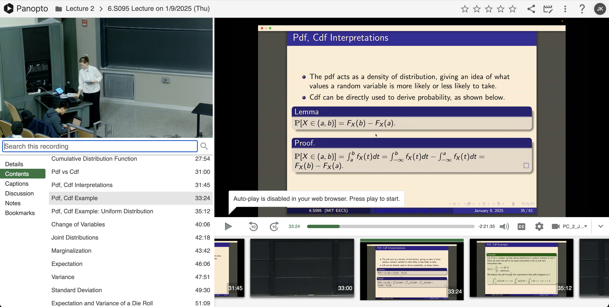
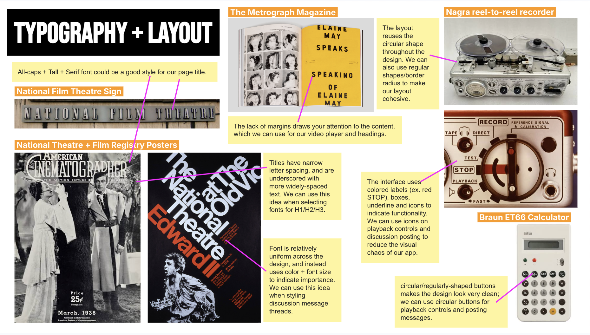
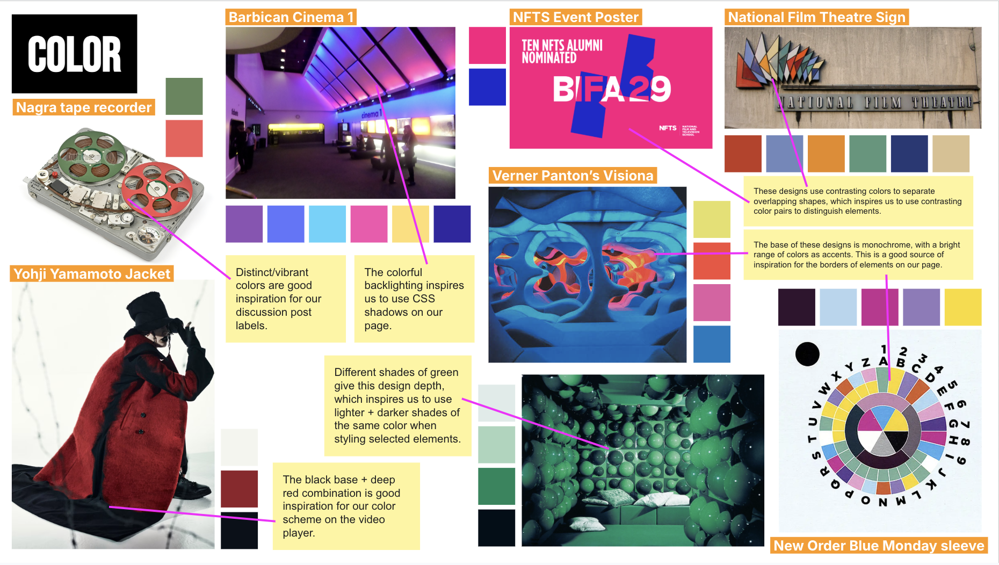

# Final Project 3: Concept Design

## Revised Problem Framing

### Domain

At MIT, recorded lectures are a resource that students use to review material before exams, review missed lectures, and revisit concepts that they did not understand the first time. MIT courses are frequently hosted on general-purpose platforms like YouTube -- such as MIT's [6.5940](https://www.youtube.com/@MITHANLab/live) -- and educational platforms like Panopto video. Reviewing a recording offers students the option to pause and rewind, allowing them to work through content at their own pace.

<p align="center">
  
  <br>
  <em>MIT's Panopto view. (source: MIT 6.S095 2025)</em>
</p>

Though recorded lectures offer the benefit of replay, watching alone gives students fewer opportunities to ask questions as they arise. Recitations often fill that gap: if an instructor's explanation is unclear, a student may ask follow-up questions and obtain clarification. Classmates can also offer their own explanations while the material is still in front of them. In contrast, a student watching the recording alone may have to work out connections on their own.

For this reason, some students prefer reviewing past material in groups, where they can stop at points of confusion and discuss. Group review can take place in person or remotely. In person, students can share notes and stream lecture videos, talking out loud and using a chalkboard to work through steps. Virtually, students can share notes or stream a lecture recording over a call, but the virtual environment can demand more coordination to work together than what is required in person.


### Bad Situations

When students review a recorded lecture remotely, they may use a call to discuss the material while one student shares the video. This lets the group watch the same recording, but it can make it harder for individuals to move at their own pace or revisit the discussion afterward. This creates several bad situations:

1. **Centralized playback controls.** Three classmates are reviewing a recorded lecture before an exam. When the lecturer moves to the next slide, one student is still trying to follow the previous equation. They ask the person sharing to rewind, but the video jumps back too far. The student has trouble explaining at what moment they want to pause, and the person sharing faces the added challenge of managing everyone's requests.
2. **Reduced video quality.** Two students are reviewing a recorded lecture in which the instructor walks through an implementation. The text in the code editor appears blurry in the screen share, making it difficult for one student to read the code as the instructor explains it. The student misses out on a key portion of the lecture, or they must open the recording themselves and review the content separately or asynchronously.
3. **Lost discussion context.** During a study group review, a student asks about a concept that was explained vaguely in lecture, and a classmate explains it. The next day, the student encounters the same concept on a practice exam, but can't recall their classmate's reasoning. The student can return to the lecture recording to rewatch the instructor's explanation, but they would need to work it out again or ask their classmate to repeat their explanation.

### Evidence and Corroboration

In researching existing study methods and qualms, we found that some students prefer and feel motivated by the group-study format, and some are underwhelmed by current technology's capacity for virtual collaboration. For instance, a 2014 study[^1] experimented with giving students separate controllers of a course video versus one shared controller, and found that the students paused much more frequently when each given their own controller, engaging in discussion during breaks. This supports the idea that giving each student playback control could encourage more discussion. The study, however, did not measure learning outcomes in either case, so we cannot definitively say which education style is most effective.

We additionally found several examples of students facing collaboration difficulties when taking asynchronous or virtual classes. One student on r/McMaster[^2] described in a reply that "we do not get to learn from other students' questions", which was one of their major concerns with asynchronous lectures. Another student on r/UPSC[^3] expressed praise for a "watch party method" for review, describing how their exam prep group watched two recorded lectures per day over Zoom or Google Meet; however, they also described centralized controls as advantageous for keeping the group on track. These anecdotes support that there is desire for live and historical discussion, though they complicate the case for shared controls.

Finally, we found an example of a Watch2Gether user who wanted to revisit a discussion after watching a video with someone else. In a post on the Watch2Gether forum[^4], the user asked whether they could access their previous messages, and a reply explained that Watch2Gether did not retain room chat history. Although this evidence is limited to one user's request, it suggests that there is potential demand for an option to return to conversations after watching together. For a study group, the same limitation could make it difficult to recover a classmate's explanation later.

### Workarounds and comparables

Students can currently use screen-sharing platforms or alternative synced-playback applications when they want to watch a lecture together. These approaches make some form of collaboration possible, but each introduces friction or leaves one of the bad situations unresolved.

#### Workarounds

**Screen sharing.** Students can join a video call, and rely on one person's screenshare to watch the lecture synchronously. Everyone sees the same recording, but the person sharing handles playback requests, small text can be hard to read, and out-loud discussion goes undocumented.

**Separate playback.** While in a call together, students can independently open the original video and control their own player. But, when someone wants to discuss a specific moment, they have to tell everyone else which timestamp to jump to. To revisit the discussion context later, someone has to write down both the explanation and its timestamp.

Several existing applications also provide the capacity for shared video discussion, but each has drawbacks in their support for collaboration.

#### Comparables

**FaceTime SharePlay.** [SharePlay](https://support.apple.com/guide/iphone/shareplay-watch-listen-play-iphb657eb791/ios) lets students watch a video in sync during a FaceTime call, with each participant able to pause or rewind for the group. However, the feature is only supported within FaceTime on iOS and MacOS devices, presenting barriers to groups of students with Android users. Students also have the option of returning to a recording later, but the lack of timestamped history makes it challenging to identify key moments.

**Watch2Gether.** 
With [Watch2Gether](https://w2g.tv/en/), one student can create a private room and send classmates a link to join. Students can watch a video in sync and discuss it in the room's live chat, allowing the group to pause or rewind together. However, Watch2Gether does not retain room chat history[^4], so students who refresh the page can lose explanations shared during the session.

**Annoto.** [Annoto](https://www.annoto.net/) adds timestamped comments to an existing video player, allowing students to revisit a classmate's explanation alongside the part of the lecture it refers to. 
However, Annoto's platform requires individual course setup, led by a "teacher" role who must enable commenting. This extra configuration makes Annoto challenging to use for informal study groups, and during live review the group still has to coordinate playback separately.

### Solution sketch

We propose WatchParty, a web-based application for small groups to collaborate and review recorded lectures. We would like for students to have the option to learn and contribute both synchronously and asynchronously: during a live session, students would control playback together and contribute to a timestamped live chat. After the session, students could return to the room, watch at their own pace, and revisit and add to the same discussion. The following features will support our goals:

- **Integrated video player.** Students would watch the lecture in an embedded player, so they could stream in HD directly from the source video. Our application can initially support YouTube, with Panopto as a (verified) possible extension.
- **Shared playback controls.** Students can pause or rewind for the group from their own player, and see others' actions on their view. The entire group can stop to address a question, and understand what moments caused confusion.
- **Private study rooms.** A student could create a room and invite classmates by sharing a link, making it easy for others to join.
- **Timestamped discussion.** Students could attach questions and replies to a specific moment in the recording, allowing students to quickly identify moments of discussion.
- **Discussion history.** Students could return after the session to revisit various parts of the lecture, or add new questions and replies. Additionally, the history could include an AI-generated overview of the group's discussion, helping students quickly find the questions and explanations most relevant to their review.

### Ethical analysis

In our ethical analysis, we have considered the following potential impacts of the use of WatchParty:

- **Confidence to pause** *(Stakeholders -- Direct Stakeholders)*
  - When students need more time to follow an explanation, it may feel daunting to pause or rewind for the whole group.
  - In response, we could add a feature allowing students to flag a particular timestamp without explicitly pausing the whole group. Other members of the group can choose to address flags as they arise (like a raised hand), or periodically stop to address them (like a lecture pause for questions).
- **Overreliance on summaries** *(Values -- Consider Key Values at Stake)*
  - Students may rely strictly on the discussion or AI overview to quickly review the lecture, undermining the benefit of watching the lecture themselves, spending time on the material, and asking their own questions.
  - In response, we could limit the visibility and generation of AI overviews for each stream. A student would need to explicitly click to request an AI overview, encouraging them to first view the video and lecture content themselves.
- **Use for casual viewing** *(Time -- Reappropriation)*
  - Over time, people may shift to using WatchParty for casual YouTube viewing (much like Watch2Gether). This could make it easier for friends to spend time together online, through live reactions or later replies.
  - We would add a live "reaction" feature (like the heart in YouTube's live chat) while maintaining nested discussion posting, so that users can more clearly express themselves in casual viewing, and repurpose the chat for either use case.
- **Answer credibility** *(Stakeholders -- Indirect Stakeholders)*
  - The platform has the potential to impact course instructors who do not use it, as instead of relying on staff explanations, students may share and propagate incorrect explanations that the instructor cannot correct within the private room.
  - In response, we can have an AI-powered feature that parses discussion to detect potential answers, and labels them as unverified. This can caution students to rely on provided answers, without offering explicit value judgement (correct vs. incorrect).
- **Fragmented review** *(Pervasiveness -- Widespread Use)*
  - If private rooms become the norm for exam review, useful explanations might only circulate among the classmates invited to one room, whereas the rest of the class could benefit from hearing those answers.
  - In response, we could create a "class group" feature, where a stream's link is made automatically accessible to a group of users. Students can add each other to groups, making history accessible to a larger group who may benefit.
- **Deletion of posts** *(Values -- Value Tensions)*
  - A student may want to have control over which discussion posts of theirs are kept up, but deleting a post could delete insightful answer threads and lessen the benefit of review.
  - In response, we could let students edit their own posts. The "edit" option may encourage students to follow-up on their own posts rather than deleting them, supporting the goal to maintain discussion history.

## Concept Design


In addition to generic `Authenticating` and `Sessioning` concepts used to manage user accounts and identity, we have the following four concepts to describe the core functionality of WatchParty: `RoomJoining`, `Streaming`, `Discussing`, and `Summarizing`.

### RoomJoining

```text
concept RoomJoining [Identity]
purpose Allow a group to gather privately for a shared activity.
principle One user creates a room;
  They share the code with a second user, who joins by code;
  The user leaves the room, and later they may rejoin using their saved participant.
state
  a set of Rooms with
    a unique code String
    an owner Identity

  a set of Participants with
    a room Room
    an identity Identity
    a name String
    an active Flag
    a lastActivityAt DateTime
    unique room and identity

  Rule: Each Participant name must be nonempty and at most 32 characters.
actions
  create (identity: Identity, name: String) : return (room: Room, participant: Participant, code: String)
    where the name is between 1-32 characters
    then generate a random code not shared by any other room;
         create a Room with that code, and identity as owner;
         create a Participant with the created room, given identity, and given name, active = true and lastActivityAt = the current time;
         return the room, participant, and code.

  join (code: String, identity: Identity, name?: String) : return (room: Room, participant: Participant)
    where the code identifies an existing room;
          name is supplied if no Participant exists for that room and identity, and (if supplied) is between 1-32 characters
    then if there already exists a Participant for that room and identity, use it and preserve its name;
         otherwise create a Participant with the room, identity, and provided name;
         set active = true and lastActivityAt to the current time;
         return the room and participant.

  transferOwnership (room: Room, current: Participant, successor: Participant)
    where the current Participant belongs to and owns the given room, and is active;
          successor is an active Participant in it
    then change the given room's owner to the successor's identity.

  leave (participant: Participant)
    where the given participant exists
    then set the participant's active flag to false.

  recordActivity (room: Room, identity: Identity) : return (participant: Participant)
    where there exists a Participant with the given identity and room
    then update that Participant's activity time to the current time;
         return the Participant for that identity and room.
```

**Note.** The purpose of the Participants schema is to enable tracking of both current and past room participants. By creating a unique participant for each joining identity and room, we can recall who joined previously, fetch the display name they used before, and keep track of whether they are currently active. Additionally, the `recordActivity` action allows a generic way to indicate "activity" (ex. a stream or discussion action) without it necessarily being a room leave or join.

### Streaming

```text
concept Streaming [Scope, Viewer, Media]
types
  Playback is PLAYING or PAUSED
  Control is PLAY or PAUSE or SEEK
purpose Keep a group at the same point in a recording while they watch together.
principle A viewer opens a Stream, adds a video, and starts watching it with a group;
  Another viewer pauses the video, so playback pauses for everyone;
  A viewer rewinds and resumes playback, so the group continues watching from that point;
  Finally, the Stream ends, and its videos remain available.
state
  a set of Streams with
    a unique scope Scope
    a playback Playback
    a position Number
    a positionAt DateTime
    an optional activeEntry VideoEntry
    an optional endedAt DateTime

  a set of VideoEntries with
    a stream Stream
    a source Media
    an order Number
    unique stream and order

  a seq of ControlEvents with
    an operation Control
    a viewer Viewer
    a stream Stream
    an entry VideoEntry
    a position Number
    an offset Number

  Rule: Any Stream with an endedAt has an activeEntry, and is paused.
  Rule: Each Stream's activeEntry belongs to that Stream.
actions
  open (scope: Scope) : return (stream: Stream)
    then if there is an existing Stream for the given scope, return it;
         else create a Stream with the given scope paused at 0, positionAt = current time, and no activeEntry or endedAt. Return it.

  addVideo (stream: Stream, source: Media) : return (entry: VideoEntry)
    where the given stream exists
    then create a VideoEntry with the given stream and source;
         set order to zero if the stream has no VideoEntries, else 1 + (its highest existing order);
         return that VideoEntry.

  start (stream: Stream, entry: VideoEntry)
    where the Stream exists, has no activeEntry or endedAt, and contains the given VideoEntry
    then set the stream's activeEntry to the given VideoEntry, playback to PAUSED, position to zero, and positionAt to the current time.

  switchVideo (stream: Stream, entry: VideoEntry)
    where the Stream is live (has an activeEntry and no endedAt), and contains the VideoEntry
    then if the VideoEntry is already active, leave playback as it is;
         otherwise set activeEntry to the given VideoEntry, playback to PAUSED, position to zero, and positionAt to the current time.

  control (stream: Stream, viewer: Viewer, entry: VideoEntry, operation: Control, position?: Number, offset?: Number) : return (changed: Flag)
    where the Stream exists, has an activeEntry, and has no endedAt;
          entry equals the Stream's activeEntry;
          if the operation is SEEK, exactly one of position or offset is supplied.
    then if the operation causes no change (i.e. playback = PLAYING and operation = PLAY, or PAUSED + PAUSE), return false;
         calculate the Stream's current position: (stored position) if PAUSED, and add + (current time - positionAt) if PLAYING.
         for SEEK operations: set the Stream's position to the supplied position, or current position plus offset;
         for PLAY or PAUSE operations: set the Stream's position to the current position, and playback to PLAYING or PAUSED respectively;
         set positionAt to the current time;
         add a ControlEvent with the given stream, entry, viewer, operation, the Stream's resulting position, and supplied offset if exists for SEEK (or zero otherwise);
         return true.

  end (stream: Stream) : return (ended: Flag)
    where the Stream exists and is live (has an activeEntry, and no endedAt)
    then follow the same procedure as in control to compute and update the stream's current position;
         set playback to PAUSED;
         set positionAt and endedAt to the current time;
         return true.
```

**Notes:** 
- The overall purpose of `Streaming` actions and `Streams`/`ControlEvents` schema is to allow for users to simultaneously control the stream each from their own machines. The `VideoEntries` schema is also useful for historical record, where the table can be queried for its Media (i.e. video from some source) when a user does independent playback.
- The purpose of storing `positionAt` is to allow a user to catch up with the current stream even if an action has not occurred recently. For instance, if a user joins mid-stream, they will be able to calculate where users are currently at, and sync with their stream.
- There is an alternative design in which we have no `offset` argument/field, and skips like +10 are just registered as [current position + 10]. We chose to distiguish `offset` and `position` because they have fundamentally different intentions, and this allows the viewer to distinguish "someone skipped 10s forward" from "someone jumped to time xx:xx" (the latter is less intuitive).

### Discussing

```text
concept Discussing [Topic, Author, Anchor, Context]
purpose Allow users to discuss specific (anchored) parts of a topic, and revisit their discussion.
principle An author starts a thread at an anchor in a topic;
  A second author replies to the opening message;
  Later, a user returns to that anchor, and reads the thread and its replies.
state
  a set of Threads with
    a topic Topic
    an anchor Anchor

  a set of Messages with
    a thread Thread
    an optional parent Message
    an author Author
    a name String
    a text String
    a context Context
    a postedAt DateTime

  Rule: For each Thread, there is exactly one Message associated with it that has no parent (i.e. the opening message).
  Rule: A reply's parent belongs to the same Thread, and was posted before the reply.
actions
  startThread (topic: Topic, author: Author, name: String, anchor: Anchor, text: String, context: Context) : return (thread: Thread, message: Message)
    where the given text is nonempty
    then create a Thread with the given topic and anchor;
         create a Message with the created Thread, no parent, the given author, name, text, context, and postedAt = the current time;
         return the created thread and message.

  reply (parent: Message, author: Author, name: String, text: String, context: Context) : return (message: Message)
    where the parent Message exists and the given text is nonempty
    then create a Message with the parent's Thread, the given parent, author, name, text, context, and postedAt = the current time;
         return the Message.
```

**Note.** The purpose of the `Topic` is to give a scope for the discussion, i.e. the `VideoEntry` in the case of WatchParty. The `Anchor` differs, as it specifies the context within the topic that a thread pertains to (i.e. a timestamp).

### Summarizing

```text
concept Summarizing [Topic]
purpose Help users catch up on a topic by reading a saved overview.
principle A user requests a summary of some text about a topic;
  Later, they return and read the saved summary;
  After new material is added, they request a new summary to replace it.
state
  a set of Summaries with
    a unique topic Topic
    a content String
    a generatedAt DateTime
actions
  summarize (topic: Topic, text: String) : return (summary: Summary)
    where the given text is nonempty
    then use a text summarizer to generate an overview of the given text;
         use the existing Summary for the given topic, or create one if none exists;
         set its content to the generated overview, and generatedAt to the current time;
         return that Summary.
```

**Note.** `Summarizing` relies on an available text summarizer, which we will implement by prompting a Gemini agent. Like in `Discussing`, a `Topic` defines a scope for the summary, i.e. a particular `VideoEntry`.

### Essential reactions

Reactions can be roughly categorized by the concept they apply to. We categorize and list the key reactions of WatchParty below.

The following three reactions govern room creation, joining by invitation, and ownership transfer, respectively:

```text
when Requesting.createRoom(identity, name)
then RoomJoining.create(identity, name)

when Requesting.joinRoom(identity, code, name)
then RoomJoining.join(code, identity, name)

when Requesting.transferOwnership(identity, room, successor)
where RoomJoining: current has the given room and identity, and active = true;
      RoomJoining: the room's owner equals identity;
      RoomJoining: successor has the given room and active = true
then RoomJoining.transferOwnership(room, current, successor)
```

**Note.** We assume each request supplies an identity, which is verified through authentication and session management (intentionally omitted from our concept list, as they will be generic).

The following four reactions govern stream management and interaction:

```text
when Requesting.addVideo(identity, room, source)
where RoomJoining: participant has the given room and identity, and active = true;
      RoomJoining: the room's owner equals identity;
      Streaming: stream has scope = room
then Streaming.addVideo(stream, source)

when Requesting.startWatch(identity, room, entry)
where RoomJoining: participant has the given room and identity, and active = true;
      RoomJoining: the room's owner equals identity;
      Streaming: stream has scope = room
then Streaming.start(stream, entry)

when Requesting.controlPlayback(identity, room, entry, operation, position, offset)
where RoomJoining: participant has the given room and identity, and active = true;
      Streaming: stream has scope = room
then Streaming.control(stream, participant, entry, operation, position, offset)

when Requesting.endWatch(identity, room)
where RoomJoining: participant has the given room and identity, and active = true;
      RoomJoining: the room's owner equals identity;
      Streaming: stream has scope = room
then Streaming.end(stream)
```

**Note.** In setting type parameters, Streaming's Scope is a Room, and Viewer is a Participant. Shared playback requests would use these reactions, while independent playback would stay local to the viewer's player.

The following three reactions govern the user's contribution to discussion, and its impact on room history:

```text
when Requesting.startThread(identity, room, entry, position, text, context)
where RoomJoining: participant has the given room and identity, active = true, and name;
      Streaming: stream has scope = room, and entry belongs to stream;
      context is HISTORICAL, or context is LIVE and stream has activeEntry = entry and no endedAt
then Discussing.startThread(entry, participant, name, position, text, context)

when Requesting.reply(identity, room, parent, text, context)
where RoomJoining: participant has the given room and identity, active = true, and name;
      Discussing: parent belongs to thread, and thread has topic = entry;
      Streaming: stream has scope = room, and entry belongs to stream;
      context is HISTORICAL, or context is LIVE and stream has activeEntry = entry and no endedAt
then Discussing.reply(parent, participant, name, text, context)

when Discussing.reply(parent, participant, name, text, context): (message)
where Discussing: parent belongs to thread, and thread has topic = entry;
      Streaming: entry belongs to stream, and stream has scope = room;
      RoomJoining: participant has the given room and identity
then RoomJoining.recordActivity(room, identity)
```

**Note.** In setting type parameters, Discussing's Topic is a VideoEntry, Author is a Participant, Anchor is a timestamp, and Context is an enum with values LIVE and HISTORICAL. Notably, an accepted reply updates the participant's room activity.

Lastly, a member can request an overview of the discussion for one video entry:

```text
when Requesting.summarizeDiscussion(identity, room, entry)
where RoomJoining: participant has the given room and identity, and active = true;
      Streaming: stream has scope = room, and entry belongs to stream;
      Discussing: text contains the messages from Threads with topic = entry
then Summarizing.summarize(entry, text)
```

**Note.** In setting type parameters, Summarizing's Topic is a VideoEntry. Requests regenerate the summary for a given video, supplying the discussion messages as text.

## User Journey

Alice and Bob are students reviewing a recorded machine learning lecture before an exam. They initially watch over a call while Alice shares her screen. During an explanation of model pruning, Bob struggles to read a visual, and falls behind. He asks Alice to rewind, but she jumps past the section he wanted to revisit.

Bob signs into WatchParty, creates a private room, and shares its invitation link with Alice. He adds the lecture's YouTube link and starts the shared watch. Each student watches directly in their own player, while their playback stays synchronized.

When they reach the explanation of model pruning, Bob pauses and rewinds to that visual, and Alice's player follows his change. Bob starts a thread at that timestamp asking why those network connections can be removed. Alice replies with an explanation, and Bob adds a follow-up question. After reading her response and reviewing the visual, he understands the explanation and resumes playback for both of them.

Once they finish reviewing, Bob ends the shared watch. The next day, he encounters a pruning question on a practice exam but cannot recall Alice's reasoning. He reopens the room and requests a discussion summary to help find their earlier exchange. He reads the thread and replays that section independently, referring to Alice's reasoning while working through the practice question.

## Visual Design Study

Below are our two visual design slides, also available [here](https://docs.google.com/presentation/d/1vi8HeOgCn2IL2OZpDbWJqKiH4u38_5ZhHh5meYynQP0/edit?usp=sharing).

<p align="center">
  
  
</p>

## Design Summary

WatchParty lets students review a recorded lecture together and revisit their discussion later. Through our design, we aim to enrich the capacity for virtual collaboration by giving participants shared playback controls, enabling timestamped discussion posting, and giving students the option to generate content summaries.

In addition to generic Authenticating and Sessioning concepts, the following four concepts govern the key functionality of our application:

| Concept | Key purpose |
| --- | --- |
| **RoomJoining** | Give a group a private room they can join and return to later. |
| **Streaming** | Keep viewers at the same point during a shared watch and retain the videos for independent review. |
| **Discussing** | Let viewers ask questions about specific moments and revisit the replies later. |
| **Summarizing** | Help viewers catch up on a discussion through a saved overview. |

When investigating our bad situation and designing our concepts, we decided on the following features. Below we outline how they impacted our concepts, and the benefits they introduce for our app:

| Design decision | Connection to concepts | Benefits |
| --- | --- | --- |
| **Streaming video independently to each student.** | Streaming stores the original media source, and shares the playback state across viewers. | Students can read small text and diagrams at the quality available from the source, relieving quality issues that can arise from screensharing methods. |
| **Shared live playback controls, and independent controls on review.** | Streaming maintains a shared position for the group, and retains the video entries after the watch ends. | A student can benefit from both synchronous and asynchronous review: they can rewind for the group and discuss when they get stuck, then replay the same section at their own pace when studying alone. |
| **Keep one shared discussion across both viewing modes.** | Discussing uses Streaming's VideoEntry as its topic. | Students in either viewing mode can review and contribute to the discussion, benefiting from hearing others' ideas. Students can return to a discussion after a stream ends to review helpful explanations. | 
| **Keep a participant's room record after they leave.** | RoomJoining retains the participant's name and room history separately from whether they're active; ownership transfers require an active successor. | A history of each student's past streams is retained, so they can return to them for review. During a stream, students can also easily change who manages the video list, and ownership will not impact whether they can find/revisit a past stream. | 
| **Generate a discussion summary only upon request.** | Summarizing uses the messages from Discussing, and saves an overview for the video entry. | Students can get a quick refresher when they need one, without forcing use of the feature or using resources when a summary is not needed. The recording and original replies are available for reviewing the explanation in context. | 

Our ethical analysis raised concerns about the pressure to pause for everyone, and the risk of relying too heavily on AI summaries:
- Timestamped threads give students a way to ask about a moment without interrupting playback. In case they do not want to pause for everyone, discussion posting can invite a group to pause to answer questions as they arise, or periodically stop to address questions. 
- Making summaries optional leaves students free to start with the recording and discussion. Making summary on-request deemphasizes reliance on the feature, while still making it available to help students recall what the group covered.

As for remaining issues, we still need to think about the following points:
- **How to make content accuracy clear.** Student discussion posting and AI summaries have the potential to misunderstand lecture content and express incorrect answers. To address this, we'll think about potential verification mechanisms with AI, or structuring our page to more clearly indicate that a discussion answer is unverified.
- **Discussion post deletion.** A student may want to delete or edit their previous posts, but this introduces the risk of deleting a discussion history that may be helpful to other students. After our MVP, we will consider adding an "edit" feature, and we will find evidence for whether that would help to preserve discussion history over deletion.

## Development Plan

| By | Deliverable | Owner(s) |
| --- | --- | --- |
| **Nov 23 -- F4 Alpha** | Implement and test (generic) `Authenticating` and `Sessioning` | [Name] |
| | Adapt `RoomJoining` from personal project, and test | Julia |
| | Integrate `RoomJoining` with `Authenticating` and `Sessioning`, and test | [Name] |
| | Implement `Streaming` concept with synced interactions | Julia |
| | Implement basic `Streaming` UI with embedded YouTube video, and manually test | Julia |
| | Integrate `Streaming` with Rooms/Auth, and test | [Name] |
| | Implement `Discussing` concept, and test | [Name] |
| | Integrate `Discussing` with Streaming/Rooms/Auth, and test | [Name] |
| | Implement `Summarizing` concept with basic Gemini prompting, and test | [Name] |
| | Integrate `Summarizing` with Discussing, and test | [Name] |
| | Create wireframe UI with basic login, room joining, YouTube video, discussion, and summary request panels | All |
| **Nov 30 -- F5 Beta** | Integrate past stream history into UI | [Name] |
| | Decide global styling (fonts, colors) | All |
| | Style streaming player | [Name] |
| | Style discussion board and AI overview | [Name] |
| | Style login/room-joining page | [Name] |
| | Style history page | [Name] |
| | Manually test synced interactions, and revise | Julia |
| | Manually test login, auth, and rooming; and revise | [Name] |
| | Manually test discussion and summary; and revise | [Name] |
| | Deploy, and test shared streaming across team's machines | All |
| **Dec 7 -- F6 stretch goals** | Adapt YouTube support to MIT-hosted Panopto, and test manually | Julia |
| | Integrate `Summarizing` with `Streaming` (video overview) | [Name] |
| | Finetune AI prompting for `Summarizing` | [Name] |
| | Addressing YouTube advertisements or failures | [Name] |


We are also keeping in mind the following risks, and how we plan to mitigate them:
- **YouTube playback may behave unexpectedly, or differently across browsers.** We have already tested embedding a YouTube video and having the client make requests to start/skip/pause, and we are confident that we will be able to connect this to our backend. However, in the case that anything goes wrong, we have planned to try this out early (F4 deliverable) and separately from other concepts, and we will try to test across different machines. If we cannot get this to work consistently, we will fallback to independent playback with timestamped discussion.
- **MIT-hosted Panopto may be less compatible with shared controls.** We have tested programmatic YouTube interactions, but have only tested Panopto embedding without programmatic interactions. Since we would otherwise have a viable YouTube-based product without Panopto, we think this is ok to defer to post-Beta, and we can focus on finalizing key functionality before adding new platform support. If we have time to add Panopto, in testing, we will try all the same operations as we did with YouTube (start, play/pause, seek, moving forward/backward).
- **Gemini summaries may fail or misrepresent discussion.** With integrating AI, we run the risk of getting unreliable summaries, or generation timing out/failing. We will test this feature thoroughly across a variety of videos and see how the app handles timeout/erroras part of F5. If we really cannot get a helpful summary from AI output, we are ok with labeling this feature as nonessential, and our app will function without it.

<hr>

[^1]: [Watching MOOCs Together: Investigating Co-Located MOOC Study Groups](https://eric.ed.gov/?id=EJ1032559)

[^2]: [r/McMaster: "online uni is v hard says mac student"](https://www.reddit.com/r/McMaster/comments/iq1lre/online_uni_is_v_hard_says_mac_student/)

[^3]: [r/UPSC: "In case you find difficulty in maintaining discipline for watching lectures from telegram"](https://www.reddit.com/r/UPSC/comments/1ijygjl/in_case_you_find_difficulty_in_maintaining/)

[^4]: [Watch2Gether forum: "Is it possible to have access to my chat history?"](https://community.w2g.tv/t/is-it-possible-to-have-access-to-my-chat-history/196933)